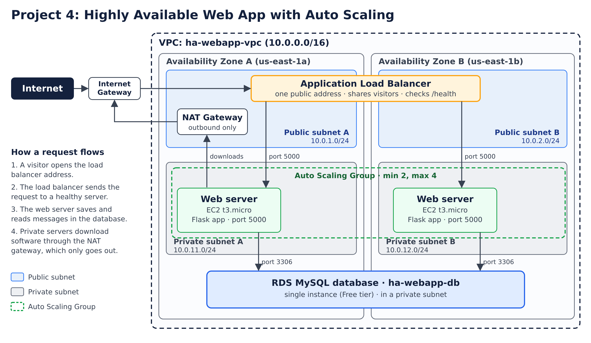
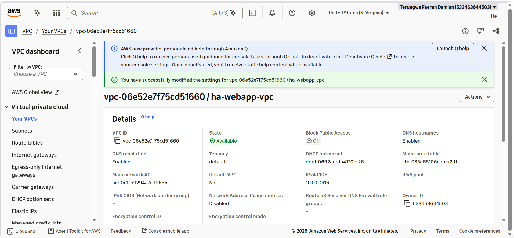
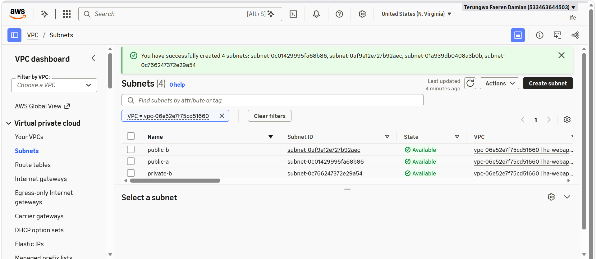
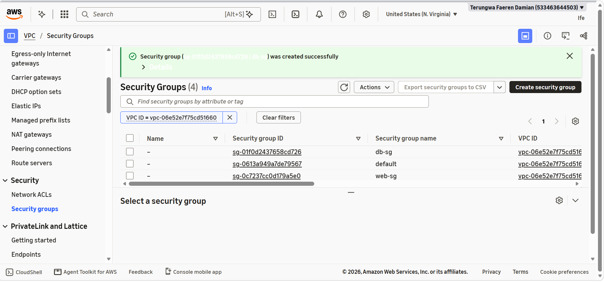
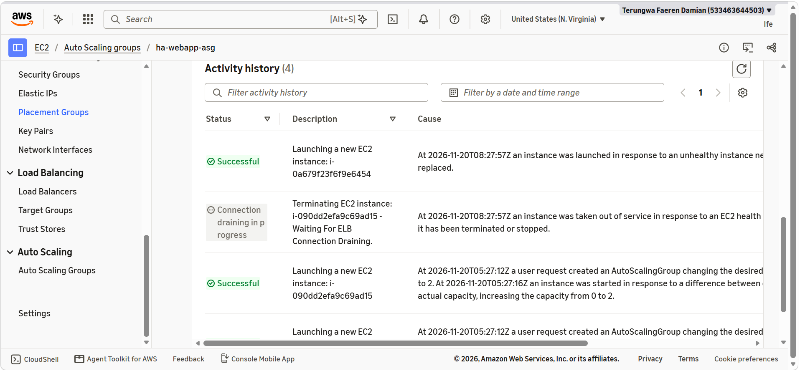

# Project 4: Highly Available Web App with Auto Scaling

**Name:** Faeren Damian Terungwa
**Course:** Cloud Computing, Neo Cloud Technologies
**Cloud:** AWS, region N. Virginia (us-east-1)

---

## 1. What this project is

A small guestbook website on AWS. Visitors can leave a message, and the message is saved in a database.

The project shows three ideas:

- **High availability:** the website runs on two servers in two different Availability Zones. If one fails, the other keeps working.
- **Auto scaling:** AWS adds or removes servers automatically depending on how busy the website is.
- **Load balancing:** one address (the load balancer) shares visitors between the servers.

Each page shows which server answered, so you can see the load balancer working.


---

## 2. How it fits together

```
Visitor --> Internet Gateway --> Load Balancer (public subnets)
                                        |
                          +-------------+-------------+
                          |                           |
                   Web server (zone A)         Web server (zone B)
                   [private subnet]            [private subnet]
                          |                           |
                          +-------------+-------------+
                                        |
                                 Database (RDS)
```

The load balancer is the only part visitors can reach. The web servers and the database are in private subnets, hidden from the internet. A NAT gateway lets the private servers download software and my code.



---

## 3. AWS services used

| Service | What it does here |
| --- | --- |
| VPC | My own private network in AWS |
| Subnets | Sections of the VPC: 2 public, 2 private, spread over 2 zones |
| Internet Gateway | Lets the public subnets talk to the internet |
| NAT Gateway | Lets private servers reach the internet for downloads, without being reachable from outside |
| Route tables | Rules that tell traffic where to go |
| Security groups | Firewalls for the load balancer, web servers and database |
| EC2 | The web servers |
| Launch template | The instructions for creating one web server |
| Auto Scaling Group | Keeps 2 servers running and adds up to 4 when busy |
| Application Load Balancer | Shares visitors across the servers and checks they are healthy |
| RDS (MySQL) | The database that stores the messages |

Other tools: Python (Flask), HTML, CSS, Bash, Git and GitHub.

---

## 4. Files in this repository

```
highlyavailable-webapp-autoscaling/
├── application/
│   ├── app.py              The website's code (Python Flask)
│   ├── requirements.txt    Python packages needed
│   ├── templates/
│   │   └── index.html      The web page
│   └── static/
│       └── style.css       The page styling
├── scripts/
│   └── userdata.sh         Sets up each new server automatically
├── images/                 Screenshots
└── README.md
```

- `app.py` runs the website. It shows the page, saves messages to the database, and has a `/health` page that the load balancer uses to check the server is alive.
- `userdata.sh` runs when a new server starts. It installs the software, downloads this code from GitHub and starts the website.

---

## 5. Steps I followed

### Step 1: VPC
Created a VPC named `ha-webapp-vpc` with the range `10.0.0.0/16`.



### Step 2: Four subnets

| Name | Zone | Range |
| --- | --- | --- |
| public-a | us-east-1a | 10.0.1.0/24 |
| public-b | us-east-1b | 10.0.2.0/24 |
| private-a | us-east-1a | 10.0.11.0/24 |
| private-b | us-east-1b | 10.0.12.0/24 |



### Step 3: Internet Gateway and public route table
Created an internet gateway and attached it to the VPC. Made a route table `public-rt` with a route `0.0.0.0/0` to the internet gateway, and linked it to both public subnets. This is what makes them public.


### Step 4: NAT Gateway and private route table
Created a NAT gateway in `public-a`. Made a route table `private-rt` with a route `0.0.0.0/0` to the NAT gateway, and linked it to both private subnets.


### Step 5: Security groups

| Name | Allows |
| --- | --- |
| alb-sg | Web traffic (port 80) from anywhere |
| web-sg | Port 5000, only from alb-sg |
| db-sg | MySQL (port 3306), only from web-sg |

This way the internet can only reach the load balancer, and the database can only be reached by the web servers.



### Step 6: Database (RDS)
Created a MySQL database `ha-webapp-db` in the private subnets, with public access turned off, using security group `db-sg`, and a first database named `guestbook`.

Note: my account only allows the Free tier template, so the database is a single instance. In a real production system I would turn on Multi-AZ so a standby copy takes over if the database fails.


### Step 7: Launch template
Created launch template `ha-webapp-lt`: Amazon Linux 2023, t3.micro, security group `web-sg`, and the `userdata.sh` script pasted into the User data box (with my real database address and password filled in).


### Step 8: Target group and load balancer
Created target group `ha-webapp-tg` (port 5000, health check path `/health`). Created internet-facing load balancer `ha-webapp-alb` in both public subnets with security group `alb-sg`, forwarding port 80 to the target group.


### Step 9: Auto Scaling Group
Created `ha-webapp-asg` using the launch template, in both private subnets, attached to the target group. Desired 2, minimum 2, maximum 4. Scaling rule: add servers when average CPU goes above 50%.


---

## 6. Results

Both servers showed as healthy in the target group:


### Test 1: Load balancing
I opened the load balancer address and refreshed several times. The instance ID and zone changed, which shows visitors are shared between the two servers.


### Test 2: A server fails
I terminated one web server. The website kept working through the other server, and the Auto Scaling Group started a replacement automatically.



---

## 7. Clean up

These services cost money every hour, so after the project I deleted them in this order:

1. Auto Scaling Group
2. Load balancer, then target group
3. Database
4. NAT gateway, then release its Elastic IP
5. Launch template, security groups, subnets, route tables
6. Internet gateway, then the VPC
