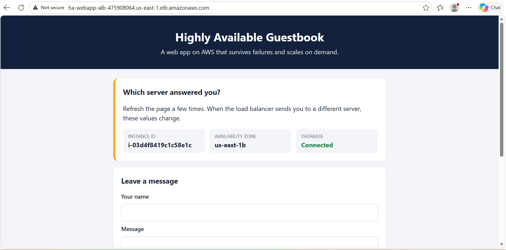
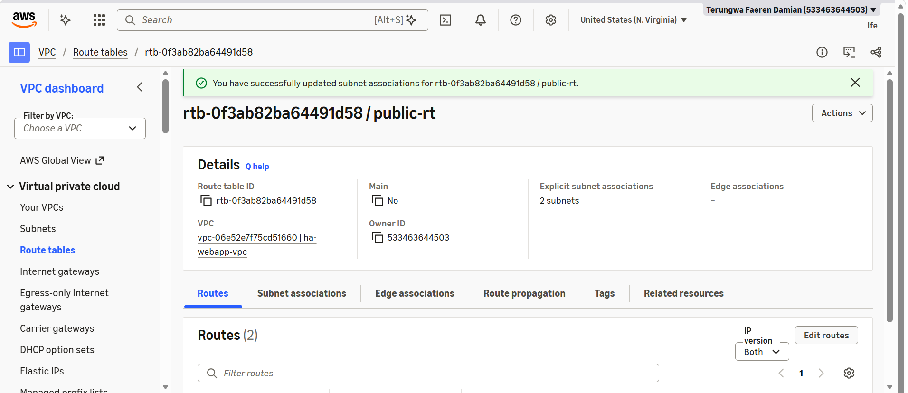
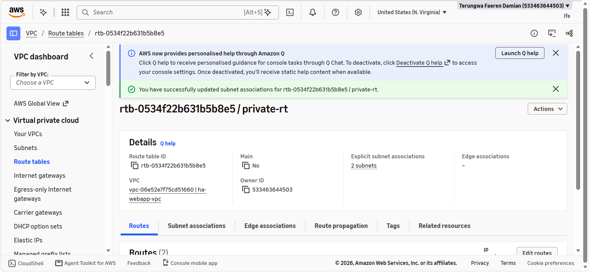
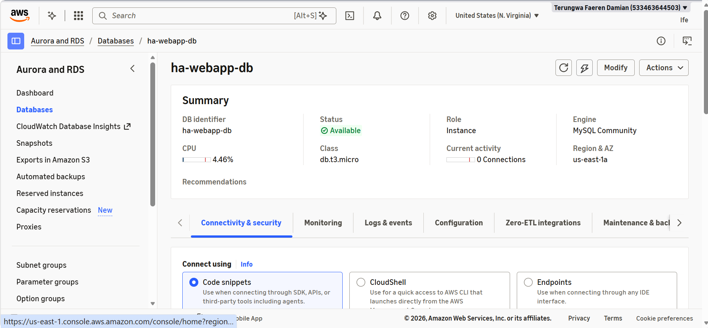
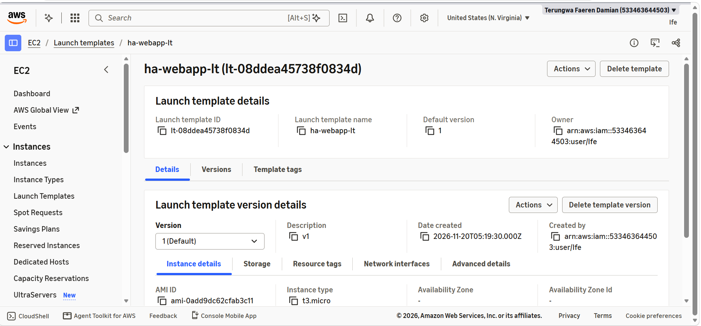
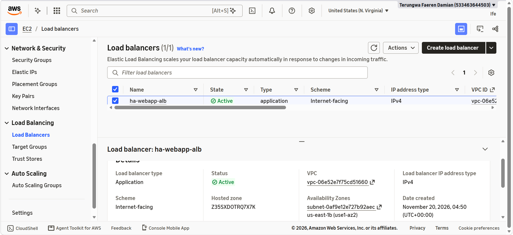
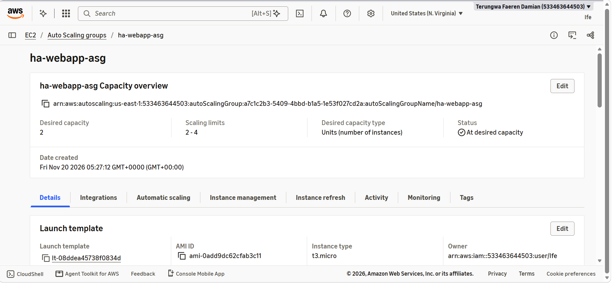
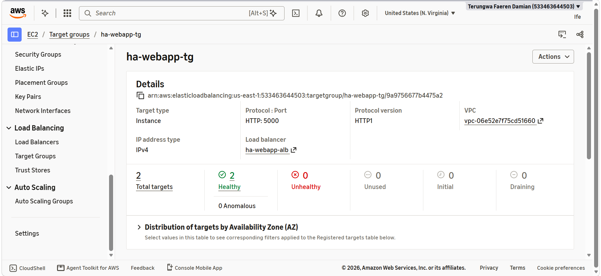
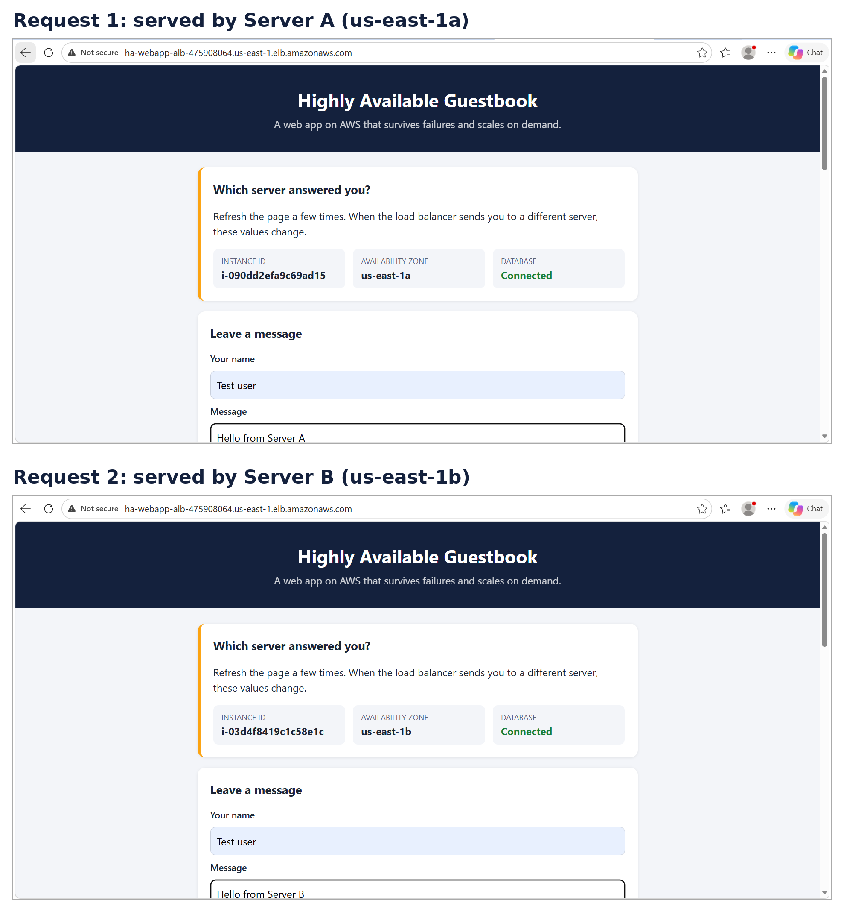
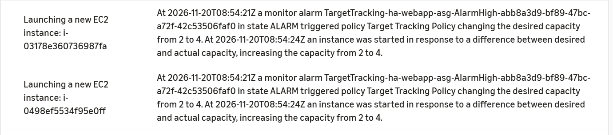

# Project 4: Highly Available Web App with Auto Scaling

**Author:** Faeren Damian Terungwa
**Programme:** Cloud Computing, Neo Cloud Technologies (Abuja)
**Cloud provider:** Amazon Web Services (AWS), region `us-east-1`

---

## 1. Project overview

This project deploys a small web application (a guestbook) on AWS so that:

- **It is highly available.** The app runs in two Availability Zones. If one zone fails, the other keeps serving visitors.
- **It scales automatically.** An Auto Scaling Group adds web servers when traffic is heavy and removes them when it drops.
- **It is secure by design.** Only the load balancer is exposed to the internet. Web servers and the database sit in private subnets.
- **Its data is protected.** The database is Amazon RDS MySQL with a Multi-AZ standby that takes over if the primary fails.

Every page of the app shows which server (instance ID and zone) answered the request, so load balancing is visible on screen.

> **Screenshot:** the finished app in the browser
> 

---

## 2. Architecture

```
Internet --> Internet Gateway --> Application Load Balancer (public subnets, 2 AZs)
                                         |
                       +-----------------+-----------------+
                       |                                   |
              Private subnet A                    Private subnet B
              EC2 web server (ASG)                EC2 web server (ASG)
              RDS primary  <------ sync ------>   RDS standby
                       |
              NAT Gateway (public subnet A) lets private servers reach the internet for downloads
```

> **Screenshot / diagram:** architecture diagram
> 

### Network plan

| Component | Value |
| --- | --- |
| Region | us-east-1 (N. Virginia) |
| VPC | `ha-webapp-vpc`, `10.0.0.0/16` |
| Public subnet A | `10.0.1.0/24` in us-east-1a |
| Public subnet B | `10.0.2.0/24` in us-east-1b |
| Private subnet A | `10.0.11.0/24` in us-east-1a |
| Private subnet B | `10.0.12.0/24` in us-east-1b |

---

## 3. Tools and AWS services used

| Service / tool | Role in this project |
| --- | --- |
| **VPC** | My own private network inside AWS |
| **Subnets** (public and private) | Split the VPC into sections, each inside one Availability Zone |
| **Internet Gateway** | Door between the VPC and the internet |
| **NAT Gateway** | Lets private servers make outbound requests (updates, GitHub) without being reachable from outside |
| **Route tables** | Rules that decide where network traffic goes |
| **Security groups** | Virtual firewalls forming a chain: ALB, web servers, database |
| **EC2** | The web servers |
| **Launch template** | The recipe for building one web server |
| **Auto Scaling Group** | Keeps 2 to 4 servers running, replaces failed ones, scales on CPU |
| **Application Load Balancer + target group** | Public entry point, spreads traffic, checks server health |
| **RDS MySQL (Multi-AZ)** | Managed database with an automatic standby copy |
| **CloudWatch** | Metrics and alarms that drive scaling |
| **Python 3, Flask, PyMySQL, gunicorn** | The application and the server that runs it |
| **HTML and CSS** | The front end |
| **Bash (user data script)** | Sets up each new server automatically |
| **Git and GitHub** | Version control and code delivery to the servers |

---

## 4. Repository structure

```
highlyavailable-webapp-autoscaling/
├── application/
│   ├── app.py               # Flask application (routes, database logic)
│   ├── requirements.txt     # Python packages
│   ├── templates/
│   │   └── index.html       # Front-end page
│   └── static/
│       └── style.css        # Front-end styling
├── scripts/
│   └── userdata.sh          # Runs on every new server's first boot
├── images/                  # Screenshots used in this README
└── README.md
```

---

## 5. Step-by-step build

### Step 1: Create the VPC

1. VPC console, **Create VPC**, choose **VPC only**.
2. Name `ha-webapp-vpc`, IPv4 CIDR `10.0.0.0/16`.
3. Actions, Edit VPC settings, enable **DNS hostnames**.

> 

### Step 2: Create the four subnets

Create these inside `ha-webapp-vpc`, choosing the Availability Zone for each:

| Name | AZ | CIDR |
| --- | --- | --- |
| `public-a` | us-east-1a | `10.0.1.0/24` |
| `public-b` | us-east-1b | `10.0.2.0/24` |
| `private-a` | us-east-1a | `10.0.11.0/24` |
| `private-b` | us-east-1b | `10.0.12.0/24` |

> 

### Step 3: Internet Gateway and public route table

1. Create an Internet Gateway `ha-webapp-igw` and attach it to the VPC.
2. Create route table `public-rt` in the VPC.
3. Add route `0.0.0.0/0` to the Internet Gateway.
4. Associate `public-rt` with `public-a` and `public-b`.

> 

### Step 4: NAT Gateway and private route table

1. Create a NAT Gateway `ha-webapp-nat` in **public-a**, allocating a new Elastic IP.
2. Wait until its state is **Available**.
3. Create route table `private-rt` in the VPC.
4. Add route `0.0.0.0/0` to the NAT Gateway.
5. Associate `private-rt` with `private-a` and `private-b`.

> 

### Step 5: Security groups

Create three security groups in the VPC. Each one only trusts the layer in front of it.

| Name | Inbound rule |
| --- | --- |
| `alb-sg` | HTTP 80 from `0.0.0.0/0` |
| `web-sg` | Custom TCP 5000 from **`alb-sg`** |
| `db-sg` | MySQL/Aurora 3306 from **`web-sg`** |

> 

### Step 6: Create the RDS database

1. RDS, **Create database**, Standard create, engine **MySQL**.
2. Template: Dev/Test. Availability: **Multi-AZ DB instance** (creates the standby).
3. Instance identifier `ha-webapp-db`, class `db.t3.micro`.
4. Master username `admin` and a strong password (keep it safe).
5. Connectivity: VPC `ha-webapp-vpc`, create a new **DB subnet group** containing `private-a` and `private-b`, **Public access: No**, security group `db-sg`.
6. Additional configuration: **Initial database name** `guestbook`.
7. Wait until the status is **Available**, then copy the **endpoint**.

> 

### Step 7: Put the code on GitHub

```bash
git init
git add .
git commit -m "Project 4: highly available web app"
git branch -M main
git remote add origin https://github.com/<your-username>/highlyavailable-webapp-autoscaling.git
git push -u origin main
```

The repository must be **public** so the new servers can clone it without a login.

### Step 8: Prepare the user data script

Open `scripts/userdata.sh` and replace the five values at the top: `REPO_URL`, `DB_HOST` (the RDS endpoint), `DB_USER`, `DB_PASSWORD`, `DB_NAME`.

> Note: putting a password in user data is acceptable for a training project but not for production. See *Improvements*.

### Step 9: Create the launch template

1. EC2, Launch Templates, **Create launch template** `ha-webapp-lt`.
2. AMI: **Amazon Linux 2023**. Instance type: `t3.micro`.
3. Security group: `web-sg`. No key pair is needed.
4. Advanced details, **User data**: paste the edited `userdata.sh`.

> 

### Step 10: Create the target group and load balancer

1. EC2, Target Groups, **Create**: type Instances, protocol HTTP, port **5000**, VPC `ha-webapp-vpc`, name `ha-webapp-tg`. Health check path **`/health`**. Register no targets yet.
2. Load Balancers, **Create Application Load Balancer** `ha-webapp-alb`: Internet-facing, VPC `ha-webapp-vpc`, subnets `public-a` and `public-b`, security group `alb-sg`.
3. Listener: HTTP 80 forwarding to `ha-webapp-tg`.

> 

### Step 11: Create the Auto Scaling Group

1. EC2, Auto Scaling Groups, **Create** `ha-webapp-asg` using `ha-webapp-lt`.
2. Network: VPC `ha-webapp-vpc`, subnets `private-a` and `private-b`.
3. Load balancing: attach to the existing target group `ha-webapp-tg`. Turn on **ELB health checks**.
4. Group size: desired **2**, minimum **2**, maximum **4**.
5. Scaling policy: **Target tracking**, metric *Average CPU utilization*, target **50**.

> 

### Step 12: Verify

1. Wait about 5 minutes for the two servers to boot and pass health checks (target group shows **healthy**).
2. Open the load balancer's **DNS name** in a browser.
3. Post a message. Refresh several times and watch the instance ID and zone change.

> 

---

## 6. Code walkthrough

| File | What it does |
| --- | --- |
| `application/app.py` | Flask routes: `/` shows messages, `/post` saves one, `/health` answers the load balancer, `/load` burns CPU for the scaling test. Also reads the server's instance ID and zone. |
| `application/templates/index.html` | The page: a server-info card, a message form, and the recent messages list. |
| `application/static/style.css` | Layout and colours. |
| `application/requirements.txt` | Flask (web framework), gunicorn (production web server), PyMySQL (talks to MySQL). |
| `scripts/userdata.sh` | On first boot: installs software, clones the repo, saves the database settings, creates the table, and starts the app as a service. |

Design decision: `/health` does **not** query the database. Otherwise a brief database failover would make the load balancer mark every web server unhealthy and take the whole site down.

---

## 7. Testing and results

### Test 1: Load balancing
Refresh the page repeatedly. The instance ID and zone change as traffic is shared.

> 

### Test 2: Self-healing (high availability)
1. EC2, select one web server, **Instance state, Terminate**.
2. Keep refreshing the site: it stays up, served by the other server.
3. Within a few minutes the Auto Scaling Group launches a replacement.

> 

### Test 3: Auto scaling
From your computer, send many requests to the CPU-heavy endpoint (replace the address):

```bash
for i in $(seq 1 60); do curl -s http://<ALB-DNS-NAME>/load > /dev/null & done
```

Watch the ASG **Activity** tab and the CloudWatch CPU graph: CPU rises above 50% and extra servers launch (up to 4). When the requests stop, the group scales back in after a cooldown.

> 

### Test 4: Database failover
RDS, select `ha-webapp-db`, **Actions, Reboot**, tick **Reboot with failover**. The standby becomes the primary within a minute or two. The site shows a brief "Database unreachable" notice, then recovers, and the old messages are still there.

> 

---

## 8. Troubleshooting log

| Problem | Likely cause | Fix |
| --- | --- | --- |
| Targets stay **unhealthy** | `web-sg` does not allow port 5000 from `alb-sg`, or the app did not start | Fix the rule; read `/var/log/userdata.log` on the server |
| Server cannot clone from GitHub | Private subnet has no route to the NAT gateway | Check `private-rt` has `0.0.0.0/0` to the NAT |
| "Database unreachable" on the page | Wrong endpoint or password, or `db-sg` blocks `web-sg` | Recheck `userdata.sh` values and the `db-sg` rule |
| Site not opening at all | Using `https://`, or `alb-sg` missing port 80 | Use `http://` and check the rule |
| App works, but table errors | Database name `guestbook` was not set at creation | Create it, or recreate with an initial database name |

*Add your own real problems and fixes here as you meet them.*

---

## 9. Cost and cleanup

NAT Gateway, load balancer, RDS and EC2 servers all bill by the hour. When finished, delete in this order:

1. Auto Scaling Group (this removes the servers)
2. Load balancer, then target group
3. RDS database (decline the final snapshot if you do not need it)
4. NAT Gateway, then release its Elastic IP
5. Launch template, security groups, subnets, route tables
6. Detach and delete the Internet Gateway, then delete the VPC

---

## 10. Lessons learned and improvements

- Everything was built across two zones, with the one exception of the NAT Gateway. **Improvement:** one NAT Gateway per zone.
- Database credentials live in user data. **Improvement:** store them in AWS Secrets Manager and give the servers an IAM role to read them.
- The site uses HTTP. **Improvement:** add an HTTPS listener with an ACM certificate and a domain name.
- Servers download code at boot. **Improvement:** bake a ready-made AMI, or use a deployment tool, so scale-out is faster.
- Infrastructure was built by clicking in the console. **Improvement:** define it in CloudFormation or Terraform so it can be rebuilt in minutes.
